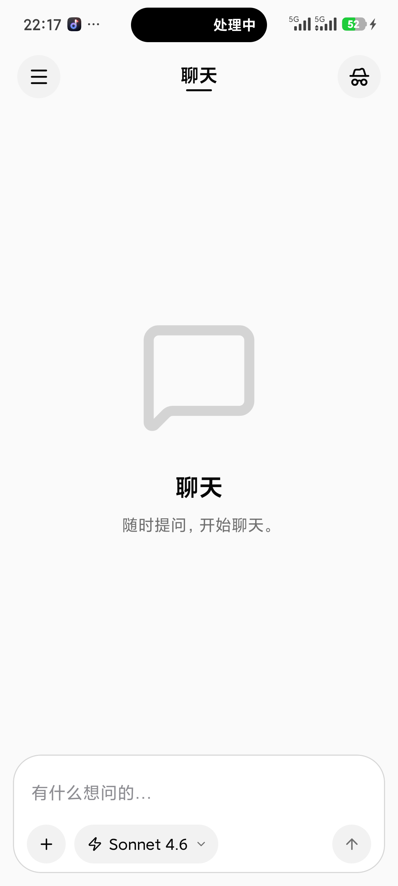
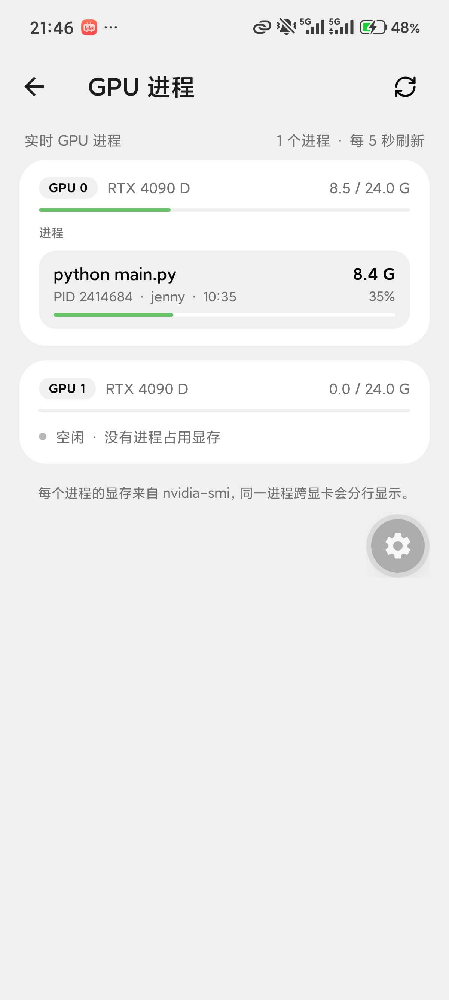

# Quest

一个跑在 Android 上的 AI 聊天客户端。界面参考 Grok：灰色画布、白色圆角卡片、底部大输入框；功能上保留了流式回复、Markdown 渲染、项目空间、会话历史和附件。

构建在 Expo Router 之上，从 [EvanBacon/chat-template](https://github.com/EvanBacon/chat-template) 起步，之后做了 Android 适配、Grok 风格改版和一批自有功能。



> **当前状态**：默认使用 DeepSeek 真实模型（`deepseek-flash` / `deepseek-v4-pro`），需要在服务端 `.env` 配置 `DEEPSEEK_API_KEY`。
> 真实模型接口只在开发环境下开放，生产环境会因为缺少身份验证直接返回 503。

## 功能

### 聊天

- 流式输出，约 30fps 节流刷新；Markdown 支持代码高亮、表格、引用、有序/无序列表
- 虚拟列表（Legend List），长对话滚动和「回到底部」按钮
- 键盘弹出时输入框跟随上移，长消息不会被遮挡
- 模型切换（输入框内的胶囊，DeepSeek V4.1 Flash / V4 Pro）与深度思考开关

### 会话历史

- 连续对话会自动生成一条左侧记录，标题取自第一条提问（超过 48 字截断）
- 记录保存在本机 `aion-chats-v1.json`，App 重启后仍在
- 点击记录恢复完整对话；支持搜索、长按删除 / 重命名 / 置顶
- 新建会话不会清空历史；删除当前会话后再次发送会重新生成记录

### 私密聊天

- 右上角礼帽按钮进入；进入和退出都会清空对话，内容不会留在普通会话里
- 独立的占位文案与水印，输入框占位符变成「临时对话」

### 抽屉

- 账号头像 + 名称、能力 / 科研 / 项目 / 设置入口
- 可折叠的会话列表，支持搜索和长按操作
- 从抽屉进入的页面，返回时会回到抽屉本身
- 抽屉只在聊天页响应左右滑动；进入其他页面时不会误触

### 项目

- 新建项目，为每个项目保存通用指令和文件
- 指令上限 4000 字，项目文件最多 4 个、合计不超过 8 MB
- 对话时可以带上项目指令，模型会把它拼进 system prompt

### 科研

- 抽屉入口，管理实验服务器连接
- 中转跑在自己电脑上，用系统 `ssh` 访问服务器；手机只保存中转地址和 token
- 支持从 `~/.ssh/config` 选主机、点状态测试连接、左滑编辑或删除
- 详情页顶部显示服务器信息和逐张显卡概览（默认 2 张，更多可展开）
- 工具入口：「显卡与系统状态」「GPU 进程」已可用，Python 环境 / 文件为占位
- 完整状态页显示 CPU、内存、磁盘、GPU 使用率、显存、温度与功耗，页面可见时每 5 秒刷新
- GPU 进程页按显卡分组，显示完整命令、PID、用户、运行时长、显存占用和占比
- 进程命令行来自 `ps -ww -o args=`，所以能看到 `python main.py` 而不只是 `python`
- 状态页和进程页离开后自动停止轮询，切到后台也会暂停，节省中转和 SSH 资源
- v1 还没有实验日志和 loss 曲线



### 附件

- 相机、相册、文件三种来源
- 单条最多 4 个附件，单个 4 MB、合计 8 MB
- 支持图片（JPEG / PNG / WebP / GIF）、PDF、文本（txt / md / csv / json）

### 其他

- 设置页：个人资料、能力开关、语言（简体中文 / English）
- 深浅色主题，设计变量用 OKLCH 定义
- 抽屉、设置、项目、科研使用统一的分组卡片语言

## 技术栈

| 层 | 选型 |
| --- | --- |
| 框架 | Expo SDK 57 · React Native 0.86.3 · React 19.2.3 |
| 路由 | Expo Router（文件路由 + typed routes） |
| 样式 | Tailwind CSS v4（Uniwind）· 设计变量在 `src/global.css` |
| 列表 | `@legendapp/list` |
| 动画/手势 | Reanimated · Gesture Handler |
| Markdown | 自研 AST 渲染（`mdast-util-from-markdown` + `react-syntax-highlighter`） |
| 模型调用 | `@ai-sdk/deepseek`（服务端路由 `src/app/api/chat+api.ts`） |
| 本地数据 | 原生写入 `expo-file-system` 文档目录（JSON），web 用 `localStorage` |
| 科研中转 | 零依赖 Node 进程，调用系统 `ssh` 和 `nvidia-smi` |

## 目录结构

```
src/
  app/                    Expo Router 路由
    index.tsx             聊天主界面
    chats.tsx             会话列表
    projects/             项目：列表 / 新建 / 详情
    research/             科研：服务器列表 / 详情 / 状态 / GPU 进程 / 中转设置
    (settings)/           设置、个人资料、能力、语言
    api/chat+api.ts       服务端流式接口
  components/
    chat/                 消息、输入框、附件、流式 store
    projects/             项目上下文与校验
    research/             中转客户端、状态/进程轮询、校验与解析
    drawer-content.tsx    抽屉、会话记录与本地持久化
    drawer-layout.tsx     抽屉手势与动画
    settings-ui.tsx       设置页的卡片 / 行 / 头像
  server/                 请求解析与校验
  utils/                  偏好、模型配置、会话记录与存储
relay/                    科研中转（Node，无第三方依赖）
tests/                    Node 原生 test 回归用例
docs/                     设计与验证记录（含截图）
```

## 开始使用

### 环境要求

- Node 20+ 与 [Bun](https://bun.sh)
- Android SDK 36 + build-tools 36.0.0，JDK 17（Gradle 工具链）
- 一台真机或模拟器

本项目使用**自定义 development build**，**不能在 Expo Go 里跑**。

### 环境变量

```bash
cp .env.example .env
```

| 变量 | 说明 |
| --- | --- |
| `EXPO_PUBLIC_MOCK_AI` | 设为 `1` 时使用内置模拟回复，不需要任何 Key；默认 `0` |
| `DEEPSEEK_API_KEY` | DeepSeek 服务端 Key，**只能放在服务端**，不要加 `EXPO_PUBLIC_` 前缀 |
| `EXPO_PUBLIC_API_URL` | 可选，部署到公网后的 `/api/chat` 完整地址；开发时默认走 Metro 主机 |
| `EXPO_UNSTABLE_DEPLOY_SERVER` | 上游用于部署服务端 API 路由，本地开发可不设 |

### 安装与运行

```bash
bun install
bun run android          # 生成原生工程并安装 debug 包
```

跑起来之后：

```bash
adb reverse tcp:8081 tcp:8081   # 拔插数据线后要重新执行
```

调试包从 Metro 拉 JS，端口转发一断就会白屏或退到桌面。

### 常用命令

| 命令 | 作用 |
| --- | --- |
| `bun start` | 只启动 Metro |
| `bun run android` | 预构建原生工程 + 编译 + 安装 debug 包 |
| `bun run android:prebuild` | 只重新生成原生工程 |
| `bun run ios` | 编译并运行 iOS（需 macOS + Xcode） |
| `bun run web` | 浏览器里跑（上游的 web 版式） |
| `bun run typecheck` | TypeScript 检查 |
| `bun run test` | 回归用例（Node 原生 test） |
| `bun run lint` | ESLint |
| `bun run android:bundle` | 导出 Android Hermes bundle 到 `dist/android` |
| `bun run relay` | 启动科研中转（也可以用 `node relay/index.mjs`） |

### 科研中转

```bash
bun run relay
```

Windows 上也可以直接双击 `relay/start-relay.bat`，效果相同，不需要打开终端。

首次启动会在 `relay/relay.config.json` 生成 token，并打印地址和 token。手机和电脑需要处在同一个 Wi-Fi 或 Tailscale 网络；Windows 第一次运行会弹防火墙提示，需要允许专用网络访问。

然后打开 Quest → 科研 → 配置中转，填入打印出来的地址和 token。中转只认识 `~/.ssh/config` 里的主机、私钥和 agent，SSH 凭据不会下发到手机。

中转提供的接口：

- `GET /health`：健康检查
- `GET/POST /servers`、`PATCH/DELETE /servers/:id`：服务器管理
- `POST /servers/:id/test`：SSH 连接测试
- `GET /servers/:id/status`：CPU / 内存 / 磁盘 / GPU 快照
- `GET /servers/:id/processes`：按 GPU 分组的进程与显存

> Debug 包允许明文 HTTP，方便连局域网；release 包默认禁止明文请求，正式使用前需要给中转配 HTTPS 或调整网络安全策略。

### 打 release 包

```bash
cd android
./gradlew assembleRelease
adb install -r app/build/outputs/apk/release/app-release.apk
```

release 包的 JS 是打包进去的，改代码不会热更新；想边改边看用 debug 包 + Metro。

## 验证

提交前至少要跑：

```bash
bun run typecheck
bun run test
bun run lint
```

回归用例覆盖：列表 footer 与键盘几何、抽屉手势与返回栈、对话生命周期、会话记录持久化、附件校验、项目校验、偏好存储、接口请求解析、科研中转校验 / SSH 失败分类 / 状态解析 / GPU 进程解析。

## 已知限制

- **模型接口只在开发环境开放**：生产环境直接返回 503；release 包要用真实模型，需要把 `/api/chat` 部署到公网并配置 `EXPO_PUBLIC_API_URL`
- **没有云同步**：对话、会话记录、项目、偏好只存在本机
- **科研模块只有连接和实时状态**：v1 不读取实验日志、不显示 loss 曲线；中转需要电脑保持开机
- **科研进程页只覆盖 NVIDIA**：依赖 `nvidia-smi`，非 NVIDIA 显卡或没有驱动的机器会显示空列表
- 设置里的「Billing / Usage / 通知 / 隐私 / 外观」等行目前是占位，点了没有行为
- 能力开关（Artifacts、代码执行、Web 搜索、记忆）只影响界面状态，还没接到模型调用链路
- Python 环境和文件浏览仍是工具占位；GPU 进程页暂不显示 CPU 占用
- iOS 侧保留了上游实现，未做本轮改版；主要验证在 Android 真机
- release 包冷启动仍偏慢，未做启动性能优化

## 相关文档

- [Android 第一阶段记录](docs/android-baseline.md)：环境、SDK 57 升级、逐条 Android 适配与验证
- [返回手势与抽屉时序](docs/quest-predictive-back.md)
- [Quest 检查报告](docs/quest-review.md)
- [界面与图标](docs/quest-artwork.md) · [语言与回复](docs/quest-language-replies.md) · [项目与侧栏](docs/quest-projects-sidebar.md)

## 许可

基于 [EvanBacon/chat-template](https://github.com/EvanBacon/chat-template)（MIT）修改，同样以 MIT 发布。
