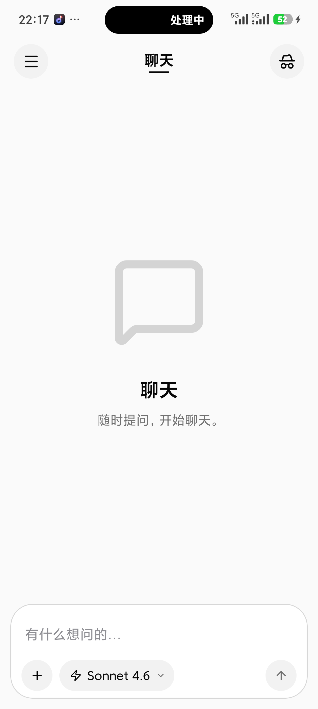

# Quest

一个跑在 Android 上的 AI 聊天客户端。界面参考 Grok：灰色画布、白色圆角卡片、底部大输入框；功能上保留了流式回复、Markdown 渲染、项目空间和附件。

构建在 Expo Router 之上，从 [EvanBacon/chat-template](https://github.com/EvanBacon/chat-template) 起步，之后做了 Android 适配、Grok 风格改版和一批自有功能。



> **当前状态**：默认走内置的模拟流式回复（`EXPO_PUBLIC_MOCK_AI=1`），不需要 API Key。
> 真实模型接口只在开发环境下开放，生产环境会因为缺少身份验证直接返回 503。

## 功能

**聊天**

- 流式输出，约 30fps 节流刷新；Markdown 支持代码高亮、表格、引用、有序/无序列表
- 虚拟列表（Legend List），长对话滚动和「回到底部」按钮
- 键盘弹出时输入框跟随上移，长消息不会被遮挡
- 模型切换（输入框内的胶囊），扩展思考开关

**私密聊天**

- 右上角礼帽按钮进入；进入和退出都会清空对话，内容不会留在普通会话里
- 独立的占位文案与水印，输入框占位符变成「临时对话」

**抽屉**

- 账号头像 + 名称、能力 / 项目 / 设置入口
- 可折叠的会话列表，支持搜索；长按可**删除 / 重命名 / 置顶**
- 从抽屉进入的页面，返回时会回到抽屉本身

**项目**

- 新建项目，为每个项目保存通用指令和文件
- 指令上限 4000 字，项目文件最多 4 个、合计不超过 8 MB
- 对话时可以带上项目指令，模型会把它拼进 system prompt

**附件**

- 相机、相册、文件三种来源
- 单条最多 4 个附件，单个 4 MB、合计 8 MB
- 支持图片（JPEG / PNG / WebP / GIF）、PDF、文本（txt / md / csv / json）

**其他**

- 设置页：个人资料、能力开关、语言（简体中文 / English）
- 深浅色主题，设计变量用 OKLCH 定义
- 抽屉、设置、项目页使用统一的分组卡片语言

## 技术栈

| 层 | 选型 |
| --- | --- |
| 框架 | Expo SDK 57 · React Native 0.86.3 · React 19.2.3 |
| 路由 | Expo Router（文件路由 + typed routes） |
| 样式 | Tailwind CSS v4（Uniwind）· 设计变量在 `src/global.css` |
| 列表 | `@legendapp/list` |
| 动画/手势 | Reanimated · Gesture Handler |
| Markdown | 自研 AST 渲染（`mdast-util-from-markdown` + `react-syntax-highlighter`） |
| 模型调用 | `@ai-sdk/anthropic`（服务端路由 `src/app/api/chat+api.ts`） |
| 本地数据 | 原生写入 `expo-file-system` 文档目录（JSON），web 用 `localStorage` |

## 目录结构

```
src/
  app/                    Expo Router 路由
    index.tsx             聊天主界面
    chats.tsx             会话列表
    projects/             项目：列表 / 新建 / 详情
    (settings)/           设置、个人资料、能力、语言
    api/chat+api.ts       服务端流式接口
  components/
    chat/                 消息、输入框、附件、流式 store
    projects/             项目上下文与校验
    drawer-content.tsx    抽屉（Grok 版式）
    drawer-layout.tsx     抽屉手势与动画
    settings-ui.tsx       设置页的卡片 / 行 / 头像
    use-restore-drawer.ts 返回抽屉的时序处理
  server/                 请求解析与校验
  utils/                  偏好、模型配置、模拟数据
tests/                    Node 原生 test 回归用例
docs/                     设计与验证记录（含截图）
```

## 开始使用

### 环境要求

- Node 20+ 与 [Bun](https://bun.sh)
- Android SDK 36 + build-tools 36.0.0，JDK 17（Gradle 工具链）
- 一台真机或模拟器

本项目使用**自定义 development build**，**不能在 Expo Go 里跑**。

### 环境变量

```bash
cp .env.example .env
```

| 变量 | 说明 |
| --- | --- |
| `EXPO_PUBLIC_MOCK_AI` | 设为 `1` 时使用内置模拟回复，不需要任何 Key（默认） |
| `ANTHROPIC_API_KEY` | 真实模型 Key，**只能放在服务端**，不要加 `EXPO_PUBLIC_` 前缀 |
| `EXPO_UNSTABLE_DEPLOY_SERVER` | 上游用于部署服务端 API 路由，本地开发可不设 |

### 安装与运行

```bash
bun install
bun run android          # 生成原生工程并安装 debug 包
```

跑起来之后：

```bash
adb reverse tcp:8081 tcp:8081   # 拔插数据线后要重新执行
```

调试包从 Metro 拉 JS，端口转发一断就会白屏或退到桌面。

### 常用命令

| 命令 | 作用 |
| --- | --- |
| `bun start` | 只启动 Metro |
| `bun run android` | 预构建原生工程 + 编译 + 安装 debug 包 |
| `bun run android:prebuild` | 只重新生成原生工程 |
| `bun run ios` | 编译并运行 iOS（需 macOS + Xcode） |
| `bun run web` | 浏览器里跑（上游的 web 版式） |
| `bun run typecheck` | TypeScript 检查 |
| `bun run test` | 回归用例（Node 原生 test） |
| `bun run lint` | ESLint |
| `bun run android:bundle` | 导出 Android Hermes bundle 到 `dist/android` |

### 打 release 包

```bash
cd android
./gradlew assembleRelease
adb install -r app/build/outputs/apk/release/app-release.apk
```

release 包的 JS 是打包进去的，改代码不会热更新；想边改边看用 debug 包 + Metro。

## 验证

提交前至少要跑：

```bash
bun run typecheck
bun run test
bun run lint
```

回归用例覆盖：列表 footer 与键盘几何、抽屉手势与返回栈、对话生命周期、附件校验、项目校验、偏好存储、接口请求解析。

## 已知限制

- **没有接真实的账号体系**：生产环境的模型接口直接返回 503，避免匿名消耗额度
- **没有云同步**：对话、项目、偏好只存在本机
- 设置里的「Billing / Usage / 通知 / 隐私 / 外观」等行目前是占位，点了没有行为
- 能力开关（Artifacts、代码执行、Web 搜索、记忆）只影响界面状态，还没接到模型调用链路
- 抽屉的会话列表来自本地模拟数据，仅用于界面演示
- iOS 侧保留了上游实现，未做本轮改版；主要验证在 Android 真机
- release 包冷启动仍偏慢，未做启动性能优化

## 相关文档

- [Android 第一阶段记录](docs/android-baseline.md)：环境、SDK 57 升级、逐条 Android 适配与验证
- [Quest 检查报告](docs/quest-review.md)
- [界面与图标](docs/quest-artwork.md) · [语言与回复](docs/quest-language-replies.md) · [项目与侧栏](docs/quest-projects-sidebar.md)

## 许可

基于 [EvanBacon/chat-template](https://github.com/EvanBacon/chat-template)（MIT）修改，同样以 MIT 发布。
